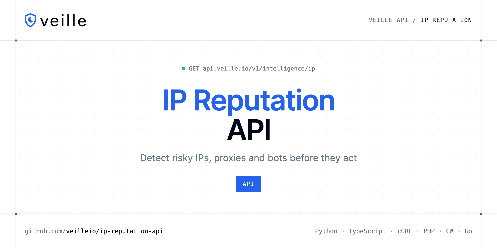

<p align="center">
  <a href="https://www.veille.io"></a>
</p>

# IP Reputation API

[](https://discord.gg/CFj3ph8aHU) [](https://app.veille.io/register) [](https://app.veille.io/openapi) [](LICENSE)

The **Veille IP Reputation API** scores an IP address so you can stop bots, abusive traffic and automated attacks.

- **IP Reputation API** — Assess the reputation of any IP address.

Use it on sign-up, login, checkout and API endpoints.

| Endpoint | Request | Credits |
|---|---|---|
| [IP Reputation API](#ip-reputation-api) | `GET /v1/intelligence/ip` | 2 |

## Table of contents

- [How it works](#how-it-works)
- [IP Reputation API](#ip-reputation-api)
- [Code examples in other languages](#code-examples-in-other-languages)
- [Use cases](#use-cases)
- [Why Veille?](#why-veille)
- [FAQ](#faq)
- [Related repositories](#related-repositories)
- [Support](#support)

## How it works

1. **Create a Veille account** and copy your API key from the [dashboard](https://app.veille.io/register).
2. **Call `https://api.veille.io`** with the header `x-api-key: YOUR_API_KEY`.
3. **Use the result** in your app — no infrastructure to run.

```bash
export VEILLE_API_KEY="your-api-key"
pip install requests        # Python
# TypeScript: Node.js 18+ (native fetch), run with `npx tsx file.ts`
```

## IP Reputation API

Assess the reputation of any IP address. Detects VPNs, proxies, Tor exit nodes, datacenter hosting, abusive traffic, and bots. Returns geolocation, network owner, and a 0-100 threat score.

`GET https://api.veille.io/v1/intelligence/ip` · **2 credits per request** · [API reference](https://app.veille.io/openapi)

### Request parameters

| Parameter | In | Type | Required | Description |
|---|---|---|---|---|
| `query` | query | string | ✅ | The IP address to analyze (IPv4 or IPv6). |

### Python example

```python
import os

import requests

API_KEY = os.environ["VEILLE_API_KEY"]
HEADERS = {"x-api-key": API_KEY}

response = requests.get(
    "https://api.veille.io/v1/intelligence/ip",
    headers=HEADERS,
    params={
        "query": "YOUR_VALUE",
    },
    timeout=120,
)
response.raise_for_status()

data = response.json()
print(data)
```

### TypeScript example

```typescript
type IpReputationApi = {
  ip?: string;
  asn?: {
    asn?: number;
    org?: string;
    type?: string;
    descr?: string;
    active?: boolean;
    domain?: string;
    country?: string;
  };
  is_tor?: boolean;
  is_vpn?: boolean;
  is_bogon?: boolean;
  is_proxy?: boolean;
  location?: {
    city?: string;
    state?: string;
    country?: string;
    latitude?: number;
    timezone?: string;
    longitude?: number;
    country_code?: string;
  };
  is_abuser?: boolean;
  is_mobile?: boolean;
  is_crawler?: boolean;
  threat_score?: number;
  is_datacenter?: boolean;
};

const headers = { "x-api-key": process.env.VEILLE_API_KEY!, "Content-Type": "application/json" };

const params = new URLSearchParams({
  "query": "YOUR_VALUE",
});

const response = await fetch(`https://api.veille.io/v1/intelligence/ip?${params}`, { headers });
if (!response.ok) throw new Error(`HTTP ${response.status}: ${await response.text()}`);

const data = (await response.json()) as IpReputationApi;
console.log(data);
```

### Output example

Example response from the API reference, abridged.

```json
{
  "ip": "82.64.12.193",
  "asn": {
    "asn": 3215,
    "org": "France Telecom - Orange",
    "type": "isp",
    "descr": "Orange S.A.",
    "active": true,
    "domain": "orange.com",
    "country": "FR"
  },
  "is_tor": false,
  "is_vpn": false,
  "is_bogon": false,
  "is_proxy": false,
  "location": {
    "city": "Paris",
    "state": "Ile-de-France",
    "country": "France",
    "latitude": 48.8566,
    "timezone": "Europe/Paris",
    "longitude": 2.3522,
    "country_code": "FR"
  },
  "is_abuser": false,
  "is_mobile": false,
  "is_crawler": false,
  "threat_score": 0,
  "is_datacenter": false
}
```

### Response fields

| Field | Type | Description |
|---|---|---|
| `ip` | string |  |
| `asn` | object |  |
| `asn.asn` | integer |  |
| `asn.org` | string |  |
| `asn.type` | string |  |
| `asn.descr` | string |  |
| `asn.active` | boolean |  |
| `asn.domain` | string |  |
| `asn.country` | string |  |
| `is_tor` | boolean |  |
| `is_vpn` | boolean |  |
| `is_bogon` | boolean |  |
| `is_proxy` | boolean |  |
| `location` | object |  |
| `location.city` | string |  |
| `location.state` | string |  |
| `location.country` | string |  |
| `location.latitude` | number |  |
| `location.timezone` | string |  |
| `location.longitude` | number |  |
| `location.country_code` | string |  |
| `is_abuser` | boolean |  |
| `is_mobile` | boolean |  |
| `is_crawler` | boolean |  |
| `threat_score` | integer |  |

## Code examples in other languages

Ready-to-run examples live in [`examples/`](examples); each reads your key from `VEILLE_API_KEY`.

| Language | `intelligence-ip` |
|---|---|
| cURL (Bash) | [intelligence_ip.sh](examples/curl/intelligence_ip.sh) |
| PHP | [intelligence_ip.php](examples/php/intelligence_ip.php) |
| C# | [IntelligenceIp.cs](examples/csharp/IntelligenceIp.cs) |
| Go | [intelligence_ip.go](examples/go/intelligence_ip.go) |
| Java | [IntelligenceIpExample.java](examples/java/IntelligenceIpExample.java) |
| Ruby | [intelligence_ip.rb](examples/ruby/intelligence_ip.rb) |
| Node.js | [intelligence_ip.mjs](examples/nodejs/intelligence_ip.mjs) |

## Use cases

- **Bot protection** — Challenge or block risky IPs at sign-up and login.
- **Fraud prevention** — Add IP risk to checkout decisions.

## Why Veille?

- **Stop fake sign-ups** — validate emails and domains before creating accounts.
- **Block abuse** — check IP reputation to stop bots and automated attacks.
- **Clean billing data** — validate VAT numbers and IBANs, get exchange rates.
- **Fast** — designed to run inline in sign-up and checkout flows.
- **Copy-paste examples** — Python and TypeScript in each README, 7 more languages in `examples/`.

## FAQ

### How do I authenticate?

Create an account on [Veille](https://app.veille.io/register), copy your API key and send it in the `x-api-key` header of every request to `https://api.veille.io`.

### How much does a request cost?

Credits per call: `/v1/intelligence/ip` **2**. See [Veille pricing](https://www.veille.io/pricing).

### Which languages are supported?

Any language that can make an HTTP request. This README shows Python and TypeScript; the [`examples/`](examples) folder contains cURL, PHP, C#, Go, Java, Ruby and Node.js.

## Related repositories

- [Email Validation API](https://github.com/veilleio/email-validation-api)
- [Email Qualification API](https://github.com/veilleio/email-qualification-api)
- [Domain Validation API](https://github.com/veilleio/domain-validation-api)
- [VAT Validation API](https://github.com/veilleio/vat-validation-api)
- [IBAN Validation API](https://github.com/veilleio/iban-validation-api)
- [Exchange Rates API](https://github.com/veilleio/exchange-rates-api)
- [All Veille repositories](https://github.com/veilleio)

## Support

- 💬 Join the [Discord](https://discord.gg/CFj3ph8aHU) to ask questions and share what you build.
- 📚 Read the [API reference](https://app.veille.io/openapi).
- 🔑 [Get your API key](https://app.veille.io/register).

---

<p align="center">
  <a href="https://www.veille.io">
    <picture>
      <source media="(prefers-color-scheme: dark)" srcset="images/logo-dark.svg">
      
    </picture>
  </a>
  <br>
  <sub>Built by <a href="https://www.veille.io">Veille</a>. Examples are released under the MIT license.</sub>
</p>
